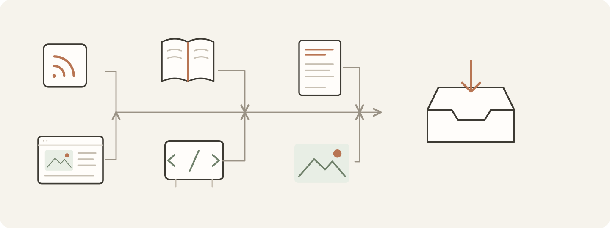
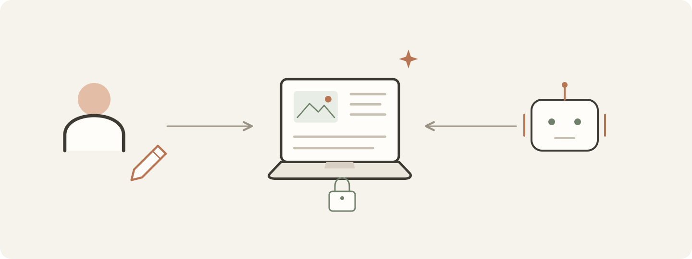
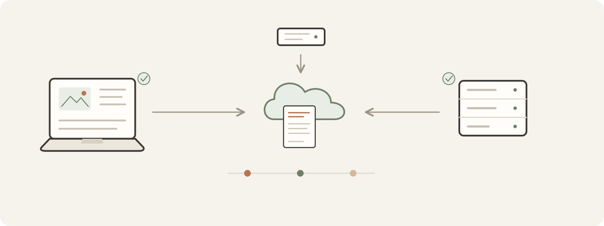
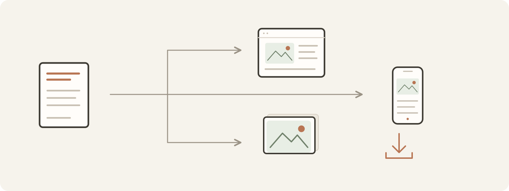
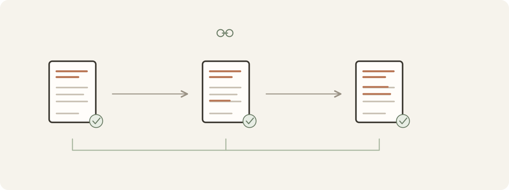
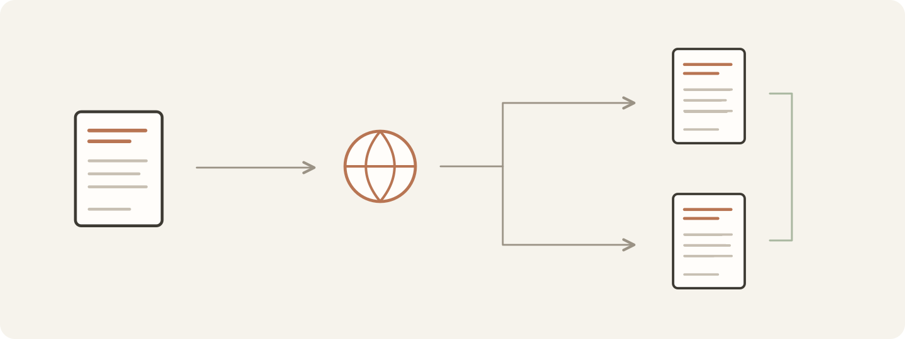
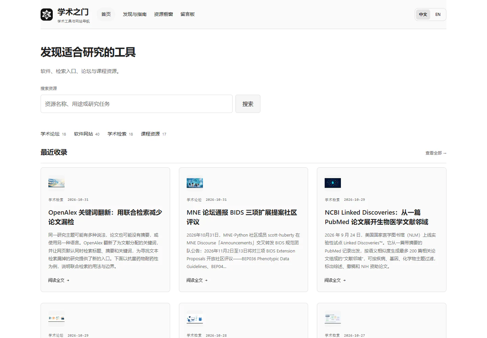
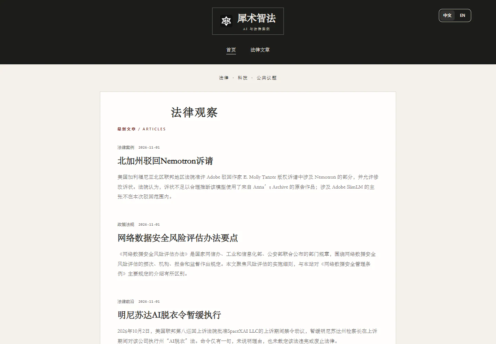
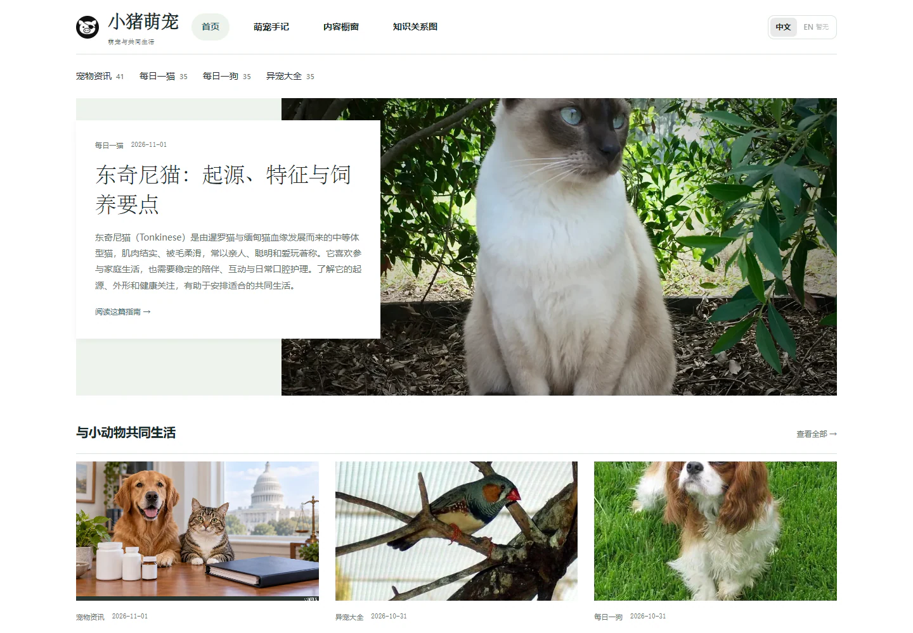
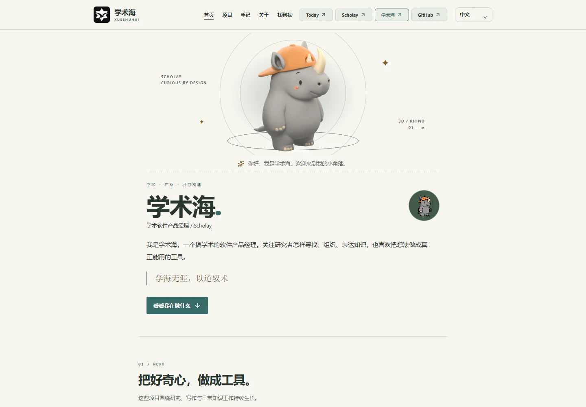

# RSSD

从 RSS、网页和自己的资料出发，完成研究、写作、翻译，再发布到自己的内容站点。

RSSD 把个人写作设备、内容中心与独立站点接在一起，适合持续阅读和创作，也适合经营多个领域的内容。这个仓库是项目的统一入口。

[下载与版本说明](https://github.com/scholay-rssd/rssd/releases) · [玩法](#怎么玩) · [资源](#需要哪些资源) · [流程](#一篇内容怎么完成) · [写作优势](#这种写法带来什么) · [十站 Demo](#十个-demo) · [开始使用](#开始使用)


## 怎么玩

| 使用方式 | 你可以做什么 |
| --- | --- |
| 个人阅读与写作 | 在 Windows / macOS 上订阅 RSS、阅读原文、选取素材，结合自己的写法完成文章，保留本地草稿。 |
| 接入内容中心 | 集中管理需求、作品、语言版本、修订和发布记录，让自己的设备参与同一套工作。 |
| 持续维护多个站点 | 在桌面或 Linux 无头环境执行写作、翻译和更新任务，为不同领域配置独立栏目、写法与主题。 |

可以先从本地阅读与写作开始，需要共享任务或站点发布时再连接中心。工作模式由使用者主动开启。

## 需要哪些资源

<table>
<tr>
<td width="50%"></td>
<td width="50%"></td>
</tr>
</table>

| 资源 | 如何准备 |
| --- | --- |
| 一台工作设备 | 使用 Windows / macOS 桌面客户端，或在 Linux 上运行无头客户端。 |
| 自己的资料 | RSS 订阅、原始网页、自有文档、书籍或公开代码仓库；按本篇问题选择资料与读取范围。 |
| 一个可用的写作智能体 | 选择并授权本机智能体，例如 Cursor、Codex 或 Claude Code。项目提供 ACP 接入与自定义命令入口，账号、额度及联网、生图能力由对应工具提供。 |
| 读者、问题与写法 | 说明写给谁、回答什么；按需选用 Skills、内容模板与品牌背景。Skills 提供研究和表达方法，模板提供起步结构。 |
| 发布环境（按需） | 运行内容中心，配置站点、域名、HTTPS 和接收器，并为目的地完成授权。主题、站点配置和连接信息分别维护。 |

阅读、自行编辑和浏览本地演示可以先独立进行。软件开源；使用外部 AI 服务和托管资源产生的费用，由相应服务商收取。新增智能体以本机实际连接与授权结果为准，接入定义见[智能体注册表](desktop/scripts/agent/agent-registry.mjs)。

## 一篇内容怎么完成

1. **定题**：选择工作空间与栏目，说明读者和本篇要回答的问题。
2. **取材**：从订阅和资料中找线索，阅读原始来源，核对关键事实并保存出处。
3. **成文**：结合写法与素材写正文，同时把补充解释、编辑取舍和核对记录放入作者备注。
4. **编辑与保存**：按需修改选定段落、提炼标题、补充图片，保存作品及对应版本。
5. **发布与维护**：提交到选定目的地，查询原请求和公开结果；后续更新继续沿用作品身份与发布记录。

<table>
<tr>
<td width="50%"></td>
<td width="50%"></td>
</tr>
</table>

作者负责选题、事实判断和编辑取舍；智能体辅助取材、研究、写作与翻译；程序负责保存、版本检查、任务状态与发布回读。作品保存、提交排队和公开发布分别记录。

## 这种写法带来什么

围绕本篇问题写核心判断、方法、步骤和例子，把作者需要保留的研究与编辑信息放在对应备注中。正文与备注在写作过程中分别记录，后续可以一起继续维护。


| 内容上的变化 | 工作流怎样支持 |
| --- | --- |
| 主线更清楚 | 正文顺着读者的问题展开，旁支解释和制作过程留在作者备注。真实来源与署名保留在公开内容中。 |
| 材料更有依据 | 为每篇选择资料、保留来源和读取范围，事实核对贯穿取材与写作。 |
| 编辑更可控 | 针对选定内容委派修改，保留人工保护和修订检查，作者可以逐处调整。 |
| 写法可以积累 | 按领域配置 Skills、模板和品牌信息，任务保留所用写法的快照。 |
| 作品可以长期更新 | 原稿、修订、语言版本和发布记录持续关联，中文与英文可以分别完成、后补翻译。 |

<table>
<tr>
<td width="50%"></td>
<td width="50%"></td>
</tr>
</table>

这种方式把**可复用的写法、可控制的编辑、可追溯的作品和可扩展的发布**放在同一条流程里。共享写作规则维护在[写作协议](contracts/article-writing-policy.mjs)，桌面和无头入口共同读取。

## 十个 Demo

以下十个线上案例展示不同领域的内容和页面风格。点击截图访问；各站的发布链路以当前部署为准。

<table>
<tr>
<td width="50%"><a href="https://today.scholay.com/"><br><strong>今日学术</strong></a><br>学术资讯、科研日历、学术历史与开源资源</td>
<td width="50%"><a href="https://metho.scholay.com/"><br><strong>研究方法</strong></a><br>研究设计、统计分析与教学文章</td>
</tr>
<tr>
<td width="50%"><a href="https://enter.scholay.com/"><br><strong>学术之门</strong></a><br>科研软件、文献检索与资源发现</td>
<td width="50%"><a href="https://study.scholay.com/"><br><strong>智能学堂</strong></a><br>课程、认证、模型排行与学习资源</td>
</tr>
<tr>
<td width="50%"><a href="https://legis.wiki/"><br><strong>犀术智法</strong></a><br>法律与科技议题、案例和政策资料</td>
<td width="50%"><a href="https://xsiching.com/"><br><strong>犀术国学</strong></a><br>经典阅读、古籍工具与课程资料</td>
</tr>
<tr>
<td width="50%"><a href="https://pet.piggytuck.com/"><br><strong>小猪萌宠</strong></a><br>物种百科、照护资料与宠物资讯</td>
<td width="50%"><a href="https://xsime.com/"><br><strong>犀术 IME</strong></a><br>产品介绍、使用文档与开发记录</td>
</tr>
<tr>
<td width="50%"><a href="https://www.piggytuck.com/"><br><strong>小猪盖被</strong></a><br>设计作品、表情图库与创作手记</td>
<td width="50%"><a href="https://pm.scholay.com/"><br><strong>学术海</strong></a><br>个人主页、产品项目与阅读手记</td>
</tr>
</table>

## 开始使用

### 下载客户端

到 [Releases](https://github.com/scholay-rssd/rssd/releases) 获取 Windows、macOS 桌面包或 Linux 无头包。当前公开包为候选开发构建，平台、签名和安装说明见对应版本页。

连接中心时，桌面使用浏览器授权，Linux 使用设备码登录，详见[中心登录与恢复](docs/center-login.md)。

### 本地看演示

准备 Node.js 24+，克隆包含子模块的公开工作区：

```sh
git clone --recurse-submodules https://github.com/scholay-rssd/rssd.git
cd rssd
npm ci
npm run demo:preview
```

打开 `http://127.0.0.1:4174/` 查看主题与结构目录，各主题在独立本地端口预览。演示使用虚构素材，涵盖文章排版、公式、图片、日历和展示模块。

### 开发与自部署

主工作区使用 Node.js 24+、pnpm 9.15.4；原生打包另需 Rust 和对应平台开发工具链。

```sh
npm run desktop:install
npm run desktop:check
npm run desktop:build:web
```

中心保留自己的构建环境和锁文件，参见 [RSSD Center](https://github.com/scholay-rssd/rssd-center)。站点接收服务见[接收器部署](docs/receiver-deployment.md)，图文与公众号输出见[浏览器导出模板](docs/browser-export-templates.md)。

## 项目组成

| 仓库 | 职责 | 工作区位置 |
| --- | --- | --- |
| [rssd](https://github.com/scholay-rssd/rssd) | 桌面、无头运行、协议、Web 引擎与接收器 | 根工作区 |
| [rssd-center](https://github.com/scholay-rssd/rssd-center) | 基于 Postiz 的内容中心 | `center/` |
| [rssd-themes](https://github.com/scholay-rssd/rssd-themes) | 主题、首页与浏览器导出模板 | `web/themes/` |
| [rssd-sites](https://github.com/scholay-rssd/rssd-sites) | 公开站点、栏目、订阅源和品牌配置 | `sites/` |
| [rssd-examples](https://github.com/scholay-rssd/rssd-examples) | 合成内容、主题与模块演示 | `web/demo/` |

各组件通过固定版本配置配合，可独立构建。欢迎从复现问题、补充来源、制作主题或改进连接器开始参与；代码检查入口为 `npm test` 和 `npm run check`。

## 版本与数据

当前为公开 v2 预览：中心协议、持久提交、设备协调、双语站点接收器和桌面中心已实现，实际设备授权、外部目的地和站点迁移仍按项验收，进展以版本说明为准。

升级前保留已有数据库、稿件和连接备份，保持原生标识 `com.thomas.papr` 与现有数据路径。公开仓库提供产品代码、公开配置和合成示例，日历种子不附带私有语料；使用者的稿件、令牌、数据库备份和私有 Git 历史独立保存。

核心自有代码采用 [MIT](LICENSE)；桌面端基于 [Papr](https://github.com/l0ng-ai/papr)，中心基于 [Postiz](https://github.com/gitroomhq/postiz-app) 并保留 AGPL-3.0。第三方代码与主题素材遵循各自许可，见 [NOTICE](NOTICE.md)。

## 友链

- [ Linux.do](https://linux.do/)
- [ 恩特学术](https://enterscholar.com/)
- [ Scholay 学术](https://www.scholay.com/)

<p align="center">
  <strong>欢迎各位站长交流学习</strong>
</p>
<p align="center">
  
</p>
